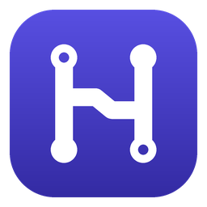

# Harness 代理启动



Harness Proxy Launcher 是一个 Windows 桌面工具。它让 Antigravity 和 Codex（ChatGPT）通过指定的 HTTP 代理启动，代理地址通过 Chromium 参数和环境变量传给应用进程及其子进程。

## 从源码运行

在 Windows 上用 PowerShell 执行以下命令。当前版本在 Python 3.12 下测试。

```powershell
git clone https://github.com/ChenKai22567/harness_proxy.git
cd harness_proxy
python -m pip install -r requirements.txt
python main.py
```

使用 Microsoft Store 版 Codex 时，先在仓库根目录生成程序包启动辅助组件。打包时会自动完成这一步。

```powershell
python -m pip install -r requirements-dev.txt
python -c "import os, build; build.build_package_helper(os.getcwd())"
```

## 启动应用

1. 打开代理客户端，查看它的 HTTP 或 Mixed 端口。主窗口预设里有 Clash / Mihomo 的 `7890`、Clash Verge 的 `7897` 等常用端口。也可以在「偏好设置」填写地址和端口，或用「自动探测端口」查找常用端口。在这里点「测试端口」可检查 TCP 监听。
2. 在 Antigravity 或 Codex 卡片上点「启动」。启动器会查找应用的安装位置。手动安装在其他目录时，可以在「偏好设置」指定可执行文件。
3. 在卡片的「更多」菜单里重启、停止应用或打开组件管理。组件窗口可以查看受管会话和子进程，也能调整 GPU 加速和批量启动设置。对外部会话执行停止或重启时，启动器会先确认并验证要接管的进程。

运行日志默认折叠。关闭窗口默认收进托盘，从托盘菜单可以重新打开主窗口。

## 预检

**Codex** 的「预检」按顺序显示代理端口、HTTP CONNECT、TLS 握手和 ChatGPT 的 HTTP 响应。主探测的时间预算为 12 秒。需要判断故障是否集中在 ChatGPT 路由时，预检会通过同一代理探测对照站点。若出现 HTTP 401 或 403，结果会标明站点已响应并显示状态码。Chromium、API 和 WebSocket 的配置标记来自启动参数和进程环境，登录和会话请求可在 Codex 内确认。

**Antigravity** 的「预检」检查安装资源和 V8 快照。安装器运行时会暂停启动和重启。看到 V8 版本冲突时，先完成更新，或用对应产品的官方安装包覆盖安装，再点「复检」。[Google Antigravity 下载](https://antigravity.google/download)

两个预检窗口都可以复制详情，包括可执行文件路径、进程 PID 和检查结果。

## 打包和快捷方式

```powershell
python -m pip install -r requirements-dev.txt
python build.py
```

构建产物位于 `dist\HarnessProxyLauncher`。打开其中的 `HarnessProxyLauncher.exe` 即可运行。分发时可以从干净的克隆目录构建，然后打包整个输出目录，使用者无需另外安装 Python。

在仓库根目录执行下面的命令可创建桌面快捷方式「Harness代理启动」。脚本优先选用打包版，也可以指向源码入口。

```powershell
& .\install_desktop_shortcut.ps1
```

## 配置与开发

运行目录里的 `config.json` 保存代理、路径和托盘设置，`managed_sessions.json` 记录受管进程，`logs\launcher.log` 保存启动日志。默认配置可查阅 [config.example.json](config.example.json)。

启用 Antigravity 的浏览器代理扩展时，启动器会查找 Node.js 和 npx。可以在「偏好设置」调整该选项。

启动 Codex 时，若所用版本支持 `respect_system_proxy` 和 `system_proxy_fallback`，启动器会通过 Codex 自带的 CLI 关闭这两个选项。需要修改 `config.toml` 时，原文件会备份到 `$CODEX_HOME/harness-proxy-backups/`。默认位置为 `%USERPROFILE%\.codex\harness-proxy-backups\`。

启动与预检代码在 [core/](core/)，界面与托盘代码在 [gui/](gui/)。运行回归测试前，安装 `requirements-dev.txt` 中的依赖。

```powershell
python -m unittest discover -s tests
```

项目的界面设计和性能测试记录见 [DESIGN_AND_PERFORMANCE_PLAN.md](DESIGN_AND_PERFORMANCE_PLAN.md)。
